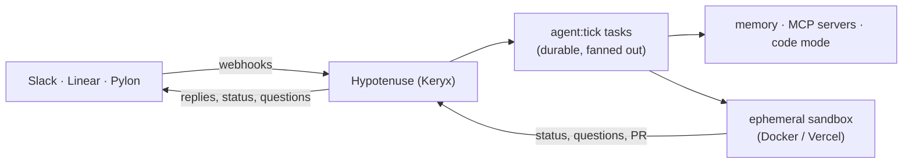

# Hypotenuse

**A headless agent your team shares — in Slack, Linear, and Pylon.**

Mention a bot in a Slack thread, delegate a Linear issue to it, or let it pick up a Pylon ticket. It answers where you
asked, with its own identity, its own tools, and its own memory of that place. When the work needs code, it starts an
ephemeral sandbox that clones the repository, makes the change, and opens a pull request — and reports back, asks
questions, or asks for help in the same conversation.

- **Bots with identities.** Each bot has its own prompts, goals, model, and its own Slack and Linear app.
- **Memory with boundaries.** Each Slack channel, Linear project, or Pylon customer has its own memory, which fades
  with disuse; the project has a shared memory every bot can read.
- **Shared tools.** A project's MCP servers and skills are shared by its bots. Every bot has **code mode**: it
  writes TypeScript that runs in an isolated WebAssembly sandbox against those tools and its memory.
- **Durable and multi-tenant.** Every message and tool call is stored; agent loops are background tasks that any
  worker can pick up, so many bots run many conversations at once and a restart loses nothing.
- **The platform's permissions, the project's RBAC.** Whoever can post where a bot is bound may talk to it. Who
  may configure it, read its transcripts, or edit its memory is decided by project roles, and every such decision is
  in the audit log.

> **Status: planned, not built.** This repository holds the design: [`docs/ARCHITECTURE.md`](./docs/ARCHITECTURE.md)
> and the phased plans in [`docs/plans/`](./docs/plans/README.md). Hypotenuse **v1** — local coding agents answering
> Linear agent sessions — is archived on the [`v1` branch](https://github.com/arcadeai-labs/hypotenuse/tree/v1).

## How it fits together

[`docs/ARCHITECTURE.md`](./docs/ARCHITECTURE.md) has the whole picture; [`AGENTS.md`](./AGENTS.md) has the rules
for building it.

## Built on

[Keryx](https://www.keryxjs.com/), with plumbing from [ToolExec](https://github.com/arcadeai-labs/toolexec) and ideas
from [botholomew](https://github.com/evantahler/botholomew), [membot](https://github.com/evantahler/membot), and
[Pi Durable](https://earendil.com/posts/pi-durable/).

## License

Apache-2.0 — see [`LICENSE`](./LICENSE).
