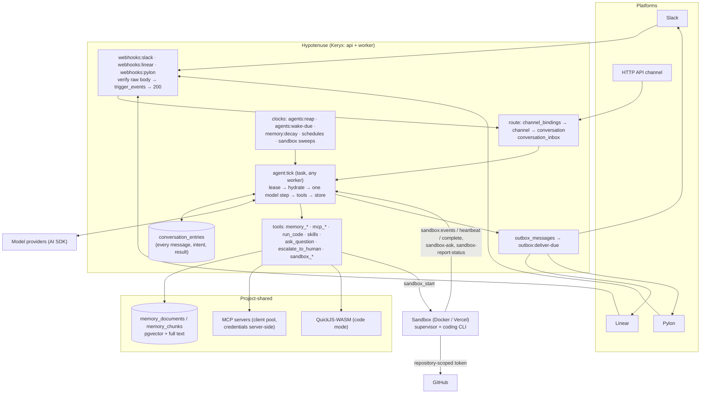

# Architecture

The system on one page. This is a live document (rule 14 in [`AGENTS.md`](../AGENTS.md)): today it describes the
system **as planned**, and each phase that lands rewrites the part it built to say what is true. The reasoning
behind each choice is in the phase that builds it — [`docs/plans/`](./plans/README.md).

## The shape

Hypotenuse is one hosted Keryx application — an **api** process that serves HTTP, WebSockets, and MCP, and a
**worker** process that runs task queues — over Postgres and Redis. It has no long-lived per-bot process: a bot
exists as rows, and it acts only when a task runs one step of one of its conversations. Code work runs in ephemeral
sandboxes the worker provisions, never on the hosts themselves.



## The data model

```
Organization ─── members (owners, members) · audit_logs (its own rows and every project's)
└── Project ─── memberships · tags (roles) · invites · audit_logs
    ├── model_connections        encrypted provider keys (Anthropic, OpenAI, Vercel AI Gateway, OpenAI-compatible)
    ├── model_aliases            named models: `default` and `fast` required, any others optional
    ├── mcp_servers              shared MCP servers; credentials never leave the server
    ├── skills                   shared skills, attached per bot
    ├── memory (project scope)   shared by every bot and channel, slow decay
    ├── github_installations · repository_grants
    └── Bot ─── identity (display name, avatar, its own Slack app + Linear app) · prompt_sections · goals ·
        │       persona · model and fast-model alias names · accessRead / accessWrite tags · helpNotifyTag · budget
        ├── bot_installations    one per platform the bot is installed on
        ├── bot_skills · bot_mcp_servers (with tool allowlists)
        ├── schedules
        └── channel_bindings ──► Channel ─── memory (channel scope, faster decay)
                                 └── Conversation ─── conversation_inbox · conversation_entries ·
                                                      approvals · help_requests · sandbox_jobs · cost_records
```

What a **channel** and a **conversation** are on each platform:

| Platform | Channel (memory boundary) | Conversation (one thread of work) |
|---|---|---|
| Slack | a channel or DM | a thread |
| Linear | a Linear project (the issue's team when it has none) | an agent session on an issue |
| Pylon | a customer account | an issue |
| HTTP API | a caller-named channel | a caller-created conversation |

## Who may do what

Two authorities, never mixed:

- **The platform's permissions decide who may talk to a bot.** Anyone who can post where a bot is bound may address
  it about that place. Senders are recorded as `participants`; Hypotenuse links no identities and adds no gate.
- **Project RBAC decides who may run a bot.** ToolExec's model, unchanged: membership (`ProjectMemberMiddleware()`),
  the reserved `admin` tag (`AdminMiddleware()`), tags as roles, and per-object `accessRead` / `accessWrite` tag
  lists, all checked by `ops/AccessOps.ts` (`canReadBot` / `canWriteBot` wrap it). Above projects sit two
  organization levels — `org-member` and `org-owner` — and an owner has admin standing in every project of the
  organization, computed in one place (`resolveProjectAccess`) and flagged as `viaOrganizationOwner`. Organization
  membership alone shows no project. Every decision a person makes is an `AuditedAction` row in `audit_logs`, filed under its project and its
  organization and naming its actor — a Hypotenuse user, a platform participant, or the system — read by project
  admins (`audit:list`) and organization owners (`organization:audit-list`).

A person reaches the same actions three ways, each resolved to one principal per request by the `beforeAct` hook
in `middleware/session.ts`: a browser session cookie; a Keryx OAuth access token on `/mcp`; or a `hyp_cli_` bearer
token from the `hypotenuse` CLI, which sets that person's `userId` in memory only. A CLI token is minted only after the
person approves it on a dashboard page (`/cli/authorize`, `/cli/activate`), and those approvals refuse a CLI token, so
one sign-in never mints another.

A bot acts with **its own** authority — its installations, its allowlisted tools, its repository grants — not the
authority of whoever is talking to it. A sandbox it starts carries a run token scoped to that job.

## Models

A bot never holds a key or a raw model id: it names two of its project's **model aliases** (`default` and `fast`
unless told otherwise), and an admin decides what each alias means — a model connection and one of its model ids.
`ModelOps.languageModel(projectId, alias)` is the only way code obtains a model: alias → connection → an AI SDK
provider from the one table of kinds in `backend/models/registry.ts`, with the key decrypted in the process making the
call. Every provider is built with the SSRF guard's `guardedFetch` (`ops/NetworkGuardOps.ts`), so a base URL a person
typed can never reach a private address, even by DNS rebinding.

## The agent loop

Built. A conversation's state is a row, and every step is a task. The rows are the orchestration state; every queued
job is an accelerant that a clock can replace.

| State | Means | Leaves it when |
|---|---|---|
| `working` | a tick holds the lease, or one is owed (`wakeRequestedAt`) | a terminal tool parks, rests, or ends it; a cancel ends it |
| `hibernating` | at rest after answering | an inbound message wakes it for a new turn |
| `waiting` | parked on a typed `waitingOn`: an `answer` (with an optional timeout) or a `timer`; `approval` and `sandbox` are reserved for the approval gate and sandbox jobs | the answer arrives (the next message), the timer or timeout is due, or it is cancelled |
| `ended` | closed with an outcome: `completed`, `failed`, or `cancelled` | an inbound message starts a new turn |

Every move into `working` goes through one operation, `ConversationOps.wake` (bot `FOR SHARE`, then conversation
`FOR UPDATE`), and enqueues `agent:tick` after commit. One tick (`ops/TickOps.ts`):

1. **Claim** the lease with one conditional `UPDATE` (`working`, no live lease); a duplicate job costs that query.
2. **Recover**: an intent with no result from an earlier lease re-runs if its tool is `replay: "safe"`, and is
   otherwise settled as an `interrupted` error the model reads.
3. **Deliver the inbox**: at a turn boundary every pending row, between steps only `steer` rows.
4. **Assemble** the system prompt from the bot (`PromptOps`), recording a `context_update` when its hash changes, and
   **hydrate** every message, reasoning part, tool call, and result from `conversation_entries` (a `compaction` stands
   in for what it summarized).
5. **Step** the model once with `streamText`, tools offered without `execute`; text deltas ping the transcript page.
   A 429, 5xx, or cut stream is retried; nothing is stored for a lost attempt.
6. **Persist** the step's entries, one `tool_call_intent` per call, and its `cost_records` row in one transaction —
   before any tool runs — then **run the calls**, each result written as it settles.
7. **Decide**: a terminal tool (`reply_and_wait`, `complete`, `fail`, `wait_for`, `ask_question`) applies its
   transition and its outbound message in the same transaction as its result; other tools loop to the next step; text
   alone is nudged once and then fails the turn. After 8 steps or 60 s the tick yields its worker and owes another.

Every write re-checks the lease under the row lock, and a heartbeat re-reads it and the cancel flag while a model call
or tool runs, so a stolen lease or a cancel aborts the step. `agents:reap` re-wakes conversations whose lease expired;
`agents:wake-due` re-enqueues owed ticks, fires timers, and times out questions. When a prompt nears the window,
`conversation:compact` summarizes the earlier turns with the bot's `fast` model; nothing is deleted, and
`search_history` reaches every entry. The first channel is the **HTTP API**: `conversation:create` / `message` /
`list` / `view` / `entries` / `cancel`, with replies optionally `POST`ed to a callback URL, HMAC-signed with the bot's
callback secret, by `outbox:deliver` (and `outbox:deliver-due`).

## Memory

Versioned markdown documents, chunked and embedded (AI SDK `embed()`), searched by **hybrid rank fusion** of pgvector
similarity and Postgres full text. Two scopes: `channel:<id>` and `project`. Scores **decay** with time since last
use — fast for channel memory, slowly for project memory — and the `memory:decay` clock retires channel memories
nobody has touched. Facts move from a channel to the project only with provenance: the conversation and entry they
came from.

## Tools and code mode

- **MCP, progressively.** A bot sees `mcp_search`, `mcp_info`, and `mcp_exec`, not every tool of every server. A
  call outside the bot's allowlist creates an `approvals` row and parks the conversation until a person decides —
  in the channel where they are, or in the dashboard.
- **Code mode.** `run_code` runs TypeScript in QuickJS compiled to WebAssembly, with a host API of `memory.*` and
  `mcp.*` and hard limits on time, memory, and calls. A gated call inside a program suspends it; approval resumes
  the same program from its recorded host calls.
- **Large results** go to memory or `large_results`, not into the context window.

## Platforms

Each platform is an adapter in `backend/channels/`: verify an inbound delivery, parse it, send, declare
capabilities, and render the **interactive surface** — status, streamed text, plan steps, questions, approvals, and
escalation — with the richest elements the platform has (Slack's streaming and Block Kit, Linear's agent activities
and elicitations, Pylon's internal notes). Ingress answers fast and works later; everything outbound goes through
`outbox_messages` with an idempotency key. Each platform has its own coverage matrix and an in-process fake.

## Sandboxes

ToolExec's design: a `SandboxProvider` interface (Docker for development and CI, Vercel for production), a
`sandboxes` ledger written before the provider is called, and an orphan sweep. A bot's `sandbox_start` creates a
`sandbox_jobs` row; a dispatch clock and a start task provision the sandbox with a run token, the Hypotenuse MCP
server scoped to that job, the shared MCP servers through a server-side proxy, and a model proxy. The supervisor
reports over HTTP (`sandbox:events`, `sandbox:heartbeat`, `sandbox:complete`); the heartbeat is the only way the
server steers it. The coding agent inside can report status, ask a question, or ask for help, and each lands in the
conversation that started the job, which waits on it and wakes when it ends. Git reaches GitHub with a
repository-scoped installation token minted per command; the pull request goes back to the conversation.

## Processes and queues

| Process | Runs |
|---|---|
| api | HTTP and WebSocket actions, MCP for people (OAuth 2.1), platform webhooks; migrations, once per deploy, in its pre-deploy (`scripts/migrate.ts`) |
| worker | task queues, drained in order: `ingress`, `outbox` (`outbox:deliver`), `agents` (`agent:tick`, `conversation:compact`), `orchestrator` (the clocks), `default` |

Postgres is the source of truth. Redis holds sessions, rate limits, leases, the task queues, and pub/sub;
WebSocket frames carry no content, and a dashboard re-reads over HTTP.
