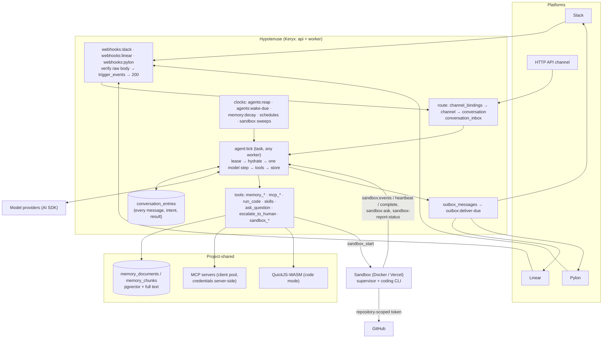

# Architecture

The system on one page. This is a live document (rule 14 in [`AGENTS.md`](../AGENTS.md)): today it describes the
system **as planned**, and each phase that lands rewrites the part it built to say what is true. The reasoning
behind each choice is in the phase that builds it — [`docs/plans/`](./plans/README.md).

## The shape

Hypotenuse is one hosted Keryx application — an **api** process that serves HTTP, WebSockets, and MCP, and a
**worker** process that runs task queues — over Postgres and Redis. It has no long-lived per-bot process: a bot
exists as rows, and it acts only when a task runs one step of one of its conversations. Code work runs in ephemeral
sandboxes the worker provisions, never on the hosts themselves.



## The data model

```
Organization ─── members (owners, members) · audit_logs (its own rows and every project's)
└── Project ─── memberships · tags (roles) · invites · audit_logs
    ├── model_connections        encrypted provider credentials, named models (incl. a fast model)
    ├── mcp_servers              shared MCP servers; credentials never leave the server
    ├── skills                   shared skills, attached per bot
    ├── memory (project scope)   shared by every bot and channel, slow decay
    ├── github_installations · repository_grants
    └── Bot ─── identity (display name, avatar, its own Slack app + Linear app) · prompt_sections · goals ·
        │       model · accessRead / accessWrite tags · helpNotifyTag · budget
        ├── bot_installations    one per platform the bot is installed on
        ├── bot_skills · bot_mcp_servers (with tool allowlists)
        ├── schedules
        └── channel_bindings ──► Channel ─── memory (channel scope, faster decay)
                                 └── Conversation ─── conversation_inbox · conversation_entries ·
                                                      approvals · help_requests · sandbox_jobs · cost_records
```

What a **channel** and a **conversation** are on each platform:

| Platform | Channel (memory boundary) | Conversation (one thread of work) |
|---|---|---|
| Slack | a channel or DM | a thread |
| Linear | a Linear project (the issue's team when it has none) | an agent session on an issue |
| Pylon | a customer account | an issue |
| HTTP API | a caller-named channel | a caller-created conversation |

## Who may do what

Two authorities, never mixed:

- **The platform's permissions decide who may talk to a bot.** Anyone who can post where a bot is bound may address
  it about that place. Senders are recorded as `participants`; Hypotenuse links no identities and adds no gate.
- **Project RBAC decides who may run a bot.** ToolExec's model, unchanged: membership (`ProjectMemberMiddleware()`),
  the reserved `admin` tag (`AdminMiddleware()`), tags as roles, and per-object `accessRead` / `accessWrite` tag
  lists, all checked by `ops/AccessOps.ts` (`canReadBot` / `canWriteBot` wrap it). Above projects sit two
  organization levels — `org-member` and `org-owner` — and an owner has admin standing in every project of the
  organization, computed in one place (`resolveProjectAccess`) and flagged as `viaOrganizationOwner`. Organization
  membership alone shows no project. Every decision a person makes is an `AuditedAction` row in `audit_logs`, filed under its project and its
  organization and naming its actor — a Hypotenuse user, a platform participant, or the system — read by project
  admins (`audit:list`) and organization owners (`organization:audit-list`).

A person reaches the same actions three ways, each resolved to one principal per request by the `beforeAct` hook
in `middleware/session.ts`: a browser session cookie; a Keryx OAuth access token on `/mcp`; or a `hyp_cli_` bearer
token from the `hypotenuse` CLI, which sets that person's `userId` in memory only. A CLI token is minted only after the
person approves it on a dashboard page (`/cli/authorize`, `/cli/activate`), and those approvals refuse a CLI token, so
one sign-in never mints another.

A bot acts with **its own** authority — its installations, its allowlisted tools, its repository grants — not the
authority of whoever is talking to it. A sandbox it starts carries a run token scoped to that job.

## The agent loop

A conversation's state is a row, and every step is a task:

| State | Means | Leaves it when |
|---|---|---|
| `working` | a tick is queued or running | the tick parks it, or ends it |
| `hibernating` | at rest, waiting for anyone to say something | an inbound message arrives |
| `waiting` | parked on a typed `waitingOn`: an `answer`, an `approval`, a `sandbox`, or a `timer` | that thing resolves, a person intervenes, or it times out |
| `ended` | finished; nothing re-engages it | a new conversation is started |

One `agent:tick`:

1. **Lease** the conversation (`FOR UPDATE SKIP LOCKED`); only one tick per conversation runs at a time.
2. **Hydrate** the full model context from `conversation_entries` — messages, tool calls, and results — plus the
   bot's rendered prompt sections and any newly delivered inbox messages.
3. **Step** the model once through the AI SDK.
4. **Write each tool call's intent**, then run the calls (independent ones in parallel), then write the results.
5. **Continue or park.** More work enqueues the next tick; a terminal tool (`reply_and_wait`, `complete`, `fail`,
   `wait_for`) parks or ends the conversation. A model that stops without one is nudged once, then the turn fails.
6. **Notify** through the outbox after commit — streamed text, status, plan steps, the reply.

Recovery is the same mechanism: an intent with no result was interrupted, and re-runs only if its tool is
replay-safe. Inbound deliveries are idempotent on the platform's id. `agents:reap` takes back expired leases;
`agents:wake-due` fires timers. Compaction runs in the background and never deletes an entry; `search_history`
reaches what fell out of the window.

## Memory

Versioned markdown documents, chunked and embedded (AI SDK `embed()`), searched by **hybrid rank fusion** of pgvector
similarity and Postgres full text. Two scopes: `channel:<id>` and `project`. Scores **decay** with time since last
use — fast for channel memory, slowly for project memory — and the `memory:decay` clock retires channel memories
nobody has touched. Facts move from a channel to the project only with provenance: the conversation and entry they
came from.

## Tools and code mode

- **MCP, progressively.** A bot sees `mcp_search`, `mcp_info`, and `mcp_exec`, not every tool of every server. A
  call outside the bot's allowlist creates an `approvals` row and parks the conversation until a person decides —
  in the channel where they are, or in the dashboard.
- **Code mode.** `run_code` runs TypeScript in QuickJS compiled to WebAssembly, with a host API of `memory.*` and
  `mcp.*` and hard limits on time, memory, and calls. A gated call inside a program suspends it; approval resumes
  the same program from its recorded host calls.
- **Large results** go to memory or `large_results`, not into the context window.

## Platforms

Each platform is an adapter in `backend/channels/`: verify an inbound delivery, parse it, send, declare
capabilities, and render the **interactive surface** — status, streamed text, plan steps, questions, approvals, and
escalation — with the richest elements the platform has (Slack's streaming and Block Kit, Linear's agent activities
and elicitations, Pylon's internal notes). Ingress answers fast and works later; everything outbound goes through
`outbox_messages` with an idempotency key. Each platform has its own coverage matrix and an in-process fake.

## Sandboxes

ToolExec's design: a `SandboxProvider` interface (Docker for development and CI, Vercel for production), a
`sandboxes` ledger written before the provider is called, and an orphan sweep. A bot's `sandbox_start` creates a
`sandbox_jobs` row; a dispatch clock and a start task provision the sandbox with a run token, the Hypotenuse MCP
server scoped to that job, the shared MCP servers through a server-side proxy, and a model proxy. The supervisor
reports over HTTP (`sandbox:events`, `sandbox:heartbeat`, `sandbox:complete`); the heartbeat is the only way the
server steers it. The coding agent inside can report status, ask a question, or ask for help, and each lands in the
conversation that started the job, which waits on it and wakes when it ends. Git reaches GitHub with a
repository-scoped installation token minted per command; the pull request goes back to the conversation.

## Processes and queues

| Process | Runs |
|---|---|
| api | HTTP and WebSocket actions, MCP for people (OAuth 2.1), platform webhooks |
| worker | migrations at boot; task queues — ingress processing, `agent:tick`, outbox delivery, sandbox provisioning, and the clocks |

Postgres is the source of truth. Redis holds sessions, rate limits, leases, the task queues, and pub/sub;
WebSocket frames carry no content, and a dashboard re-reads over HTTP.
