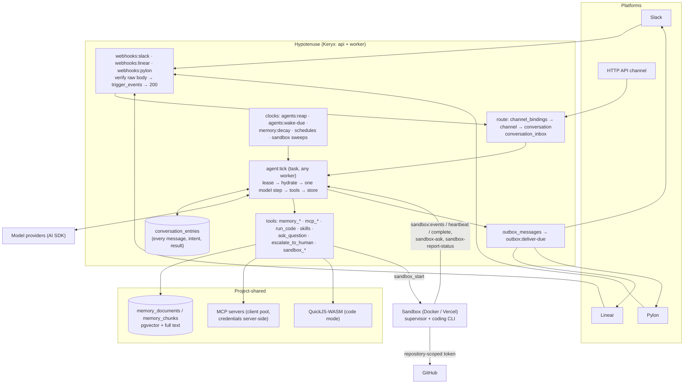

# Architecture

The system on one page. This is a live document (rule 14 in [`AGENTS.md`](../AGENTS.md)): today it describes the
system **as planned**, and each phase that lands rewrites the part it built to say what is true. The reasoning
behind each choice is in the phase that builds it — [`docs/plans/`](./plans/README.md).

## The shape

Hypotenuse is one hosted Keryx application — an **api** process that serves HTTP, WebSockets, and MCP, and a
**worker** process that runs task queues — over Postgres and Redis. It has no long-lived per-bot process: a bot
exists as rows, and it acts only when a task runs one step of one of its conversations. Code work runs in ephemeral
sandboxes the worker provisions, never on the hosts themselves.



## The data model

```
Organization ─── members (owners, members) · audit_logs (its own rows and every project's)
└── Project ─── memberships · tags (roles) · invites · audit_logs
    ├── model_connections        encrypted provider keys (Anthropic, OpenAI, Vercel AI Gateway, OpenAI-compatible)
    ├── model_aliases            named models: `default` and `fast` required, any others optional
    ├── mcp_servers              shared MCP servers; credentials never leave the server
    ├── skills                   shared skills, attached per bot
    ├── memory (project scope)   shared by every bot and channel, slow decay
    ├── github_installations · repository_grants
    ├── prompt_sections (project scope)  included in every bot's prompt; only admins change them
    └── Bot ─── identity (display name, avatar, its own Slack app + Linear app) · prompt_sections (Identity, …) ·
        │       goals · model and fast-model alias names · accessRead / accessWrite tags · helpNotifyTag · budgets
        ├── bot_installations    one per platform the bot is installed on
        ├── bot_skills · bot_mcp_servers (with tool allowlists)
        ├── schedules
        └── channel_bindings ──► Channel ─── memory (channel scope, faster decay)
                                 └── Conversation ─── conversation_inbox · conversation_entries ·
                                                      approvals · help_requests · sandbox_jobs · cost_records
```

What a **channel** and a **conversation** are on each platform:

| Platform | Channel (memory boundary) | Conversation (one thread of work) |
|---|---|---|
| Slack | a channel or DM | a thread |
| Linear | a Linear project (the issue's team when it has none) | an agent session on an issue |
| Pylon | a customer account | an issue |
| HTTP API | a caller-named channel | a caller-created conversation |
| Dashboard chat (`web`) | the bot's shared `dashboard` channel, or a fresh scratch one | a chat a member started |
| Webhook | the sender's channel id, in its workspace | the sender's conversation key |

## Who may do what

Two authorities, never mixed:

- **The platform's permissions decide who may talk to a bot.** Anyone who can post where a bot is bound may address
  it about that place. Senders are recorded as `participants`; Hypotenuse links no identities and adds no gate.
- **Project RBAC decides who may run a bot.** ToolExec's model, unchanged: membership (`ProjectMemberMiddleware()`),
  the reserved `admin` tag (`AdminMiddleware()`), tags as roles, and per-object `accessRead` / `accessWrite` tag
  lists, all checked by `ops/AccessOps.ts` (`canReadBot` / `canWriteBot` wrap it). Above projects sit two
  organization levels — `org-member` and `org-owner` — and an owner has admin standing in every project of the
  organization, computed in one place (`resolveProjectAccess`) and flagged as `viaOrganizationOwner`. Organization
  membership alone shows no project. Every decision a person makes is an `AuditedAction` row in `audit_logs`, filed under its project and its
  organization and naming its actor — a Hypotenuse user, a platform participant, or the system — read by project
  admins (`audit:list`) and organization owners (`organization:audit-list`).

A person reaches the same actions three ways, each resolved to one principal per request by the `beforeAct` hook
in `middleware/session.ts`: a browser session cookie; a Keryx OAuth access token on `/mcp`; or a `hyp_cli_` bearer
token from the `hypotenuse` CLI, which sets that person's `userId` in memory only. A CLI token is minted only after the
person approves it on a dashboard page (`/cli/authorize`, `/cli/activate`), and those approvals refuse a CLI token, so
one sign-in never mints another.

A bot acts with **its own** authority — its installations, its allowlisted tools, its repository grants — not the
authority of whoever is talking to it. A sandbox it starts carries a run token scoped to that job.

## Models

A bot never holds a key or a raw model id: it names two of its project's **model aliases** (`default` and `fast`
unless told otherwise), and an admin decides what each alias means — a model connection and one of its model ids.
`ModelOps.languageModel(projectId, alias)` is the only way code obtains a model: alias → connection → an AI SDK
provider from the one table of kinds in `backend/models/registry.ts`, with the key decrypted in the process making the
call. Every provider is built with the SSRF guard's `guardedFetch` (`ops/NetworkGuardOps.ts`), so a base URL a person
typed can never reach a private address, even by DNS rebinding.

## The agent loop

Built. A conversation's state is a row, and every step is a task. The rows are the orchestration state; every queued
job is an accelerant that a clock can replace.

| State | Means | Leaves it when |
|---|---|---|
| `working` | a tick holds the lease, or one is owed (`wakeRequestedAt`) | a terminal tool parks, rests, or ends it; a cancel ends it |
| `hibernating` | at rest after answering | an inbound message wakes it for a new turn |
| `waiting` | parked on a typed `waitingOn`: an `answer` (with an optional timeout), a `timer`, or `approval` (the approvals a step's gated tool calls wait on); `sandbox` is reserved for sandbox jobs | the answer arrives (the next message), the timer or timeout is due, every approval is decided or expired, or it is cancelled |
| `ended` | closed with an outcome: `completed`, `failed`, or `cancelled` | an inbound message starts a new turn |

Every move into `working` goes through one operation, `ConversationOps.wake` (bot `FOR SHARE`, then conversation
`FOR UPDATE`), and enqueues `agent:tick` after commit. One tick (`ops/TickOps.ts`):

1. **Claim** the lease with one conditional `UPDATE` (`working`, no live lease); a duplicate job costs that query.
2. **Recover**: an intent with no result from an earlier lease re-runs if its tool is `replay: "safe"`, and is
   otherwise settled as an `interrupted` error the model reads.
3. **Deliver the inbox**: at a turn boundary every pending row, between steps only `steer` rows.
4. **Assemble** the system prompt from the bot's sections, goals, skills, and capabilities (`PromptOps`), recording a
   `context_update` — the section versions it was built from, and what changed — when its hash changes, and
   **hydrate** every message, reasoning part, tool call, and result from `conversation_entries` (a `compaction` stands
   in for what it summarized; a person's `/<skill>` message is read as its expansion).
5. **Step** the model once with `streamText`, tools offered without `execute`; text deltas ping the transcript page.
   A 429, 5xx, or cut stream is retried; nothing is stored for a lost attempt.
6. **Persist** the step's entries, one `tool_call_intent` per call, and its `cost_records` row in one transaction —
   before any tool runs — then **run the calls**, each result written as it settles.
7. **Decide**: a terminal tool (`reply_and_wait`, `complete`, `fail`, `wait_for`, `ask_question`) applies its
   transition and its outbound message in the same transaction as its result; other tools loop to the next step; text
   alone is nudged once and then fails the turn. After 8 steps or 60 s the tick yields its worker and owes another.

Every write re-checks the lease under the row lock, and a heartbeat re-reads it and the cancel flag while a model call
or tool runs, so a stolen lease or a cancel aborts the step. `agents:reap` re-wakes conversations whose lease expired;
`agents:wake-due` re-enqueues owed ticks, fires timers, and times out questions. When a prompt nears the window,
`conversation:compact` summarizes the earlier turns with the bot's `fast` model; nothing is deleted, and
`search_history` reaches every entry. The first channel is the **HTTP API**: `conversation:create` / `message` /
`list` / `view` / `entries` / `cancel`, with replies optionally `POST`ed to a callback URL, HMAC-signed with the bot's
callback secret, by `outbox:deliver` (and `outbox:deliver-due`).

## Memory

Built ([phase 09](./plans/phase-09-memory.md)). Every memory is a markdown document addressed by a path
(`people/alex.md`), in one of two scopes:

| Scope | Key | Read by | Changed by |
|---|---|---|---|
| `channel` | `(bot, channel)` | that bot, in that channel; people with `canReadBot` | the bot's tools; people with `canWriteBot`; the decay clock |
| `project` | the project | every bot and channel; every member | project admins, and promotion (`canWriteBot` + admin) |

- **Append-only versions.** `memory_documents` holds every version; a write or edit inserts one and moves
  `is_current`, a forget inserts a tombstone, and only the decay clock deletes — non-current versions past 90 days
  that no promotion cites. Every version carries `source_type` and `source_ref`: the conversation and seqs a bot
  learned it from, the person who wrote it, or the channel version it was promoted from.
- **Search** (`MemorySearchOps`) fuses the top 50 chunks by pgvector cosine and the top 50 by `ts_rank_cd` (any of
  the query's words) with weighted reciprocal rank (k 60, semantic 0.6), keeps at most 3 chunks per document, and
  weighs each by **decay** — `exp(−ln 2 · age / half-life)` from the later of the version and its last use, floored
  at 0.25. Half-lives are per bot: 30 days for channel memory, 180 for project. Both candidate queries carry the
  read set in their `WHERE`.
- **Embeddings never block a turn.** A write commits text and chunks; `memory:embed` fills in vectors with the
  project's `embedding` alias (an OpenAI-compatible model returning 1536 dimensions), stamping an embedding
  revision. A chunk without a current vector ranks by keyword alone; a project with no embedding model searches by
  keyword.
- **Consolidation.** When a tick leaves a conversation hibernating or ended with at least 4 new entries,
  `memory:consolidate` has the bot's `fast` model extract facts into channel memory under `facts/`, each citing its
  seqs; `memory:consolidate-due` catches a lost enqueue.
- **Decay clock.** `memory:decay` (hourly) fans out `memory:decay-project`, which tombstones unpinned channel
  memory read fewer than 3 times whose decay fell below 0.05. Project memory never fades on its own.
- **Tools:** `memory_search`, `memory_list`, `memory_read` (replay safe); `memory_write`, `memory_edit`,
  `memory_forget` (unsafe, deduped by tool call id). A bot cannot change project memory: until a channel binding
  allows it, project memory changes only by a person.

## Prompts, goals, and skills

Built ([phase 11](./plans/phase-11-skills-prompts-and-goals.md)). A bot's system prompt is data, assembled in a fixed
order by `ops/PromptOps.ts` — identity, project sections, the bot's `always` sections, the `contextual` sections whose
keywords match the turn (title, latest message, channel name), active goals and any review due, the skills index,
MCP capabilities, the channel, fixed tool primers, and style rules — without calling a model.

- **Sections** (`prompt_sections`, `prompt_section_versions`) are versioned: every change, a person's or the bot's,
  is a new version; a revert writes the old text again. A new bot gets *Identity* (its persona, never bot-editable),
  *How I work*, and *Things I have learned*. Project sections are in every bot's prompt and only admins change them.
- **Budget.** Text is estimated at four characters a token against `bots.prompt_budget_tokens`; contextual sections
  are dropped from the last included to fit, and a save that would push the always-included parts over is refused.
- **Reproducible.** Each step's `promptHash` is the sha256 of the text sent. A `context_update` records the parts —
  each section by id and version, generated text verbatim — so `replayPrompt` rebuilds the exact text, and
  `prompt:preview` shows the same text a tick would send.
- **The bot edits itself, within limits.** `prompt_list` / `prompt_read` (safe), `prompt_edit` (line patches against
  a base version, only `agentEditable` bot sections) and `prompt_create` (contextual, capped by
  `bots.max_agent_sections`) write versions carrying the conversation and intent entry — unaudited machine writes,
  visible in the transcript and the version history.
- **Goals** (`goals`): people create and retitle them; the bot reads active goals in its prompt and changes only
  status and notes (`goal_list`, `goal_update`).
- **Skills** (`skills`, `skill_versions`, `bot_skills`): a project library of templates with arguments (`$1`,
  `$ARGUMENTS`, `$<name>`), access-listed like bots, attached per bot at the latest or a pinned version. The bot calls
  `skill_list` / `use_skill`; a person's message starting `/<name> args…` is expanded at delivery.

## Tools and code mode

- **MCP, progressively.** Built ([phase 10](./plans/phase-10-shared-mcp-servers.md)). A project connects
  `mcp_servers` once (Streamable HTTP; none, headers, bearer, or OAuth; credentials sealed and attached by the
  server, header values filled per bot with `{{bot.identity}}`); a bot is given servers in `bot_mcp_servers`. A
  per-process client pool (`ops/McpClientOps.ts`) connects through the SSRF guard's fetch, keyed by server,
  credential version, and headers. A bot sees `mcp_search` (keyword fused with the memory embedder over the cached
  catalog), `mcp_list_tools`, `mcp_info`, `mcp_exec`, and `read_large_result`, not every tool of every server, and a
  generated *capabilities* summary in its prompt. `mcp_list_tools` is offered to every bot — with no server it lists
  every server's tools, and for a bot with none it says so — so "what tools do you have?" is one call. `mcp_exec` needs `mcp_info` first in the conversation.
- **The approval gate** (`ops/ApprovalOps.ts`) decides each `mcp_exec` before anything is sent: an allowlist pattern
  or a read-only tool with `autoAllowReadOnly` runs; anything else writes an `approvals` row bound to the intent and
  its `callKey`, and the tick parks the step on `waiting` / `approval` after the step's other calls run. A decision
  (`approval:decide`, or `approvals:expire`) wakes the conversation when none is pending; recovery runs the approved
  intent — marked `executingAt` and committed before it is sent, consumed with its result — or refuses a denied
  one. Nothing earlier is replayed. Decided in the dashboard (the approvals inbox, or the Chat's card), the API, the
  CLI, and MCP, and in a platform channel under its binding's approval policy.
- **Code mode.** Built ([phase 12](./plans/phase-12-code-mode.md)). `run_code` runs a TypeScript program in Vercel's
  Run SDK (`run`, pinned; QuickJS compiled to WebAssembly in a worker thread, imported only by
  `ops/code/runtime.ts`), with a host API of `memory.*`, `mcp.*`, `largeResult.read`, and a captured `console`
  (`ops/code/`), each going through the same ops, read set, allowlist, and gate as the top-level tools, and limits
  no program can raise (`config/code.ts`, lowered per bot). Each call is a `code_runs` row journaling its host calls.
  A gated call interrupts the program before its effect; the tick writes one approval per interruption (bound by
  `codeRunId` and `interruptionId`), stores the continuation sealed with `CryptoOps` and signed with the project's
  own key in the same transaction, and parks. Recovery's `resume` hook replays the same program from it once
  every approval is decided — settled calls answered from the record, each approved call run once — or reports a
  crashed run interrupted with its journal. `code-run:list` / `view` read runs, never a continuation.
- **Large results** go to memory (`saveTo`) or `large_results` (a preview and an `lr_<id>` the bot pages), not into
  the context window; `large-results:sweep` deletes them 30 days after their conversation ends.

## Platforms

Built ([phase 13](./plans/phase-13-channel-framework.md)). Each place a bot talks is an adapter in
`backend/platforms/` behind one contract (`platforms/types.ts`): it declares capabilities and delivers outbox rows,
and a platform people reach the bot from also defines the per-bot app (`bot_installations`, one per bot per
workspace, its routing key hashed and its credentials sealed), verifies and parses deliveries, and names the channel.
The first three are the API's signed callback, the dashboard's Chat (`web`, whose rows are settled at enqueue because
the dashboard reads Postgres), and the generic signed `webhook` platform; Slack, Linear, and Pylon are next.

- **Ingress** (`webhooks:<type>`) reads the routing key from the raw path, verifies the signature over the raw bytes,
  records a `trigger_events` row deduped on the platform's delivery id, answers, and enqueues; every routing or
  signature failure is one byte-identical 404.
- **Processing** (`triggers:process-event`, swept by `triggers:process-pending`) applies an ordered rules table —
  loops, lifecycle, shared channels, bindings (`autoBind`), mentions, signals, interactions, rate limits — and
  delivers a message into the conversation's inbox keyed by the message, with an acknowledgement. An approval
  decided in the channel, under the binding's `participants` or `listed` policy, is audited as the participant.
- **The interactive surface** (`ops/SurfaceOps.ts`) turns a tick into `status`, `stream` (coalesced every 250 ms),
  `plan`, `message`, `question`, and `approval` rows, with fallbacks for a surface that lacks a capability. Ephemeral
  rows supersede each other; nothing is written after a question. `conversation:live` reads the current ones.
- **Delivery** (`outbox:deliver`, `outbox:deliver-due`) walks a conversation's rows in order under a Redis lease;
  a row that must wait holds the rows behind it.
- **Escalation**: `escalate_to_human` writes a `help_requests` row and notifies the bot's help tag (else admins); the
  answer (`help:answer`) resumes the conversation.

Each platform has a coverage matrix in [`docs/platform-coverage/`](./platform-coverage/webhook.md) and an in-process fake built on
`backend/__tests__/fakes/base.ts`, held to the shared conformance suite.

## Sandboxes

ToolExec's design: a `SandboxProvider` interface (Docker for development and CI, Vercel for production), a
`sandboxes` ledger written before the provider is called, and an orphan sweep. A bot's `sandbox_start` creates a
`sandbox_jobs` row; a dispatch clock and a start task provision the sandbox with a run token, the Hypotenuse MCP
server scoped to that job, the shared MCP servers through a server-side proxy, and a model proxy. The supervisor
reports over HTTP (`sandbox:events`, `sandbox:heartbeat`, `sandbox:complete`); the heartbeat is the only way the
server steers it. The coding agent inside can report status, ask a question, or ask for help, and each lands in the
conversation that started the job, which waits on it and wakes when it ends. Git reaches GitHub with a
repository-scoped installation token minted per command; the pull request goes back to the conversation.

## Processes and queues

| Process | Runs |
|---|---|
| api | HTTP and WebSocket actions, MCP for people (OAuth 2.1), platform webhooks; migrations, once per deploy, in its pre-deploy (`scripts/migrate.ts`) |
| worker | task queues, drained in order: `ingress`, `outbox` (`outbox:deliver`), `agents` (`agent:tick`, `conversation:compact`), `orchestrator` (the clocks), `default` |

Postgres is the source of truth. Redis holds sessions, rate limits, leases, the task queues, and pub/sub;
WebSocket frames carry no content, and a dashboard re-reads over HTTP.
