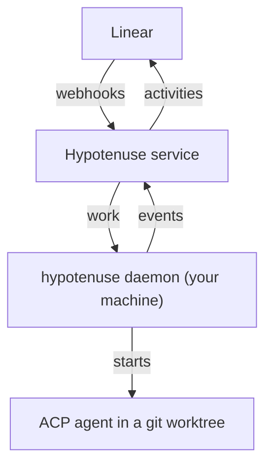

# Introduction

Hypotenuse answers Linear's agent sessions with coding agents that run on your own machines.

Delegate a Linear issue to `@hypotenuse`, or mention it in a comment. A coding agent on your laptop, or on a
teammate's build box, picks the work up in a fresh git worktree. It streams its thinking, plan, and tool calls into
the Linear agent session, opens a pull request, and replies.

## How it fits together



- **The hosted service** receives Linear's webhooks, holds the Linear credentials, and routes each session to a
  runner.
- **A [runner](/docs/runners)** is the `hypotenuse` daemon on one machine. It starts an agent in a worktree and
  reports back.
- **An agent** is any coding agent that speaks the [Agent Client Protocol](https://agentclientprotocol.com):
  Claude Code, Codex, Gemini CLI, GitHub Copilot, goose, OpenCode, Cursor, and others.

## Setting up

1. Install the CLI.
2. Sign in with `hypotenuse login`, which opens a browser.
3. Register this machine as a runner and write its config.
4. Start the daemon, then delegate an issue to `@hypotenuse` in Linear.

```bash
curl -fsSL https://raw.githubusercontent.com/arcadeai-labs/hypotenuse/main/install.sh | bash
hypotenuse login
hypotenuse runner register --name my-laptop
hypotenuse config init
hypotenuse daemon start
```

Read [why Hypotenuse](/docs/why) for the reasoning behind running agents where your code already is.
